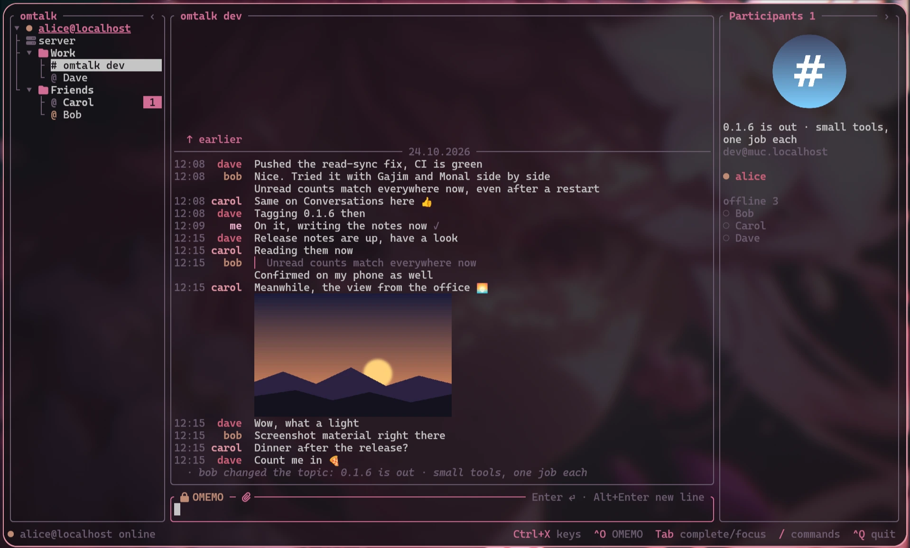
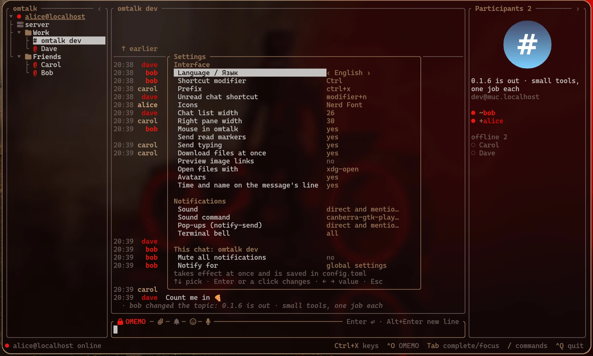
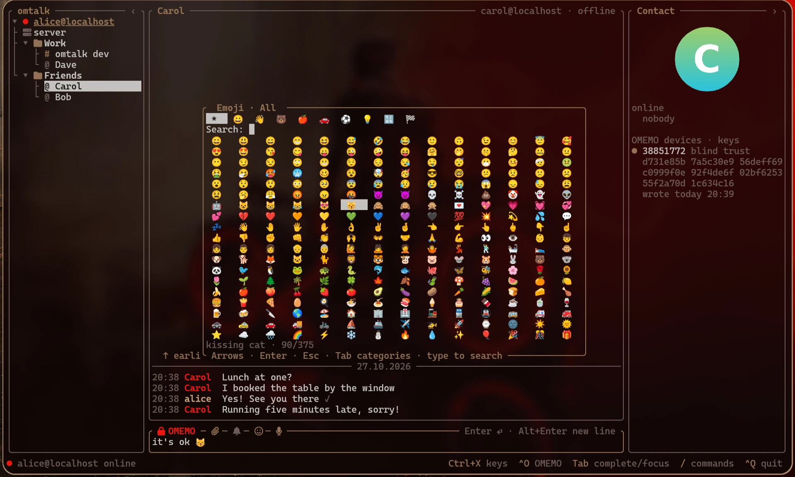

# omtalk

**English** · [Русский](README.ru.md)

A terminal XMPP and native IRC client for direct and group chats, with OMEMO for
XMPP, multiple accounts, and keyboard and mouse controls.

## Features

- OMEMO in direct chats and private groups, with device fingerprints and trust management.
- Native IRC/soju with multiple networks, history, read sync and shared file/voice controls.
- Multiple accounts, chat folders, pinned chats, room bookmarks, and optional biboumi bridges.
- Replies, edits, reactions with a list of who reacted, and message styling.
- Encrypted file sharing, pictures, searchable local history, and server archive catch-up.
- Read-state synchronization across devices, per-chat mute, and configurable notifications.
- Terminal palette colours, optional avatars, and English and Russian interfaces.

## Contents

- [Install and first run](#install-and-first-run)
- [Controls](#controls)
- [Messaging](#messaging)
- [Accounts and rooms](#accounts-and-rooms)
- [Native IRC and soju](#native-irc-and-soju)
- [Encryption and devices](#encryption-and-devices)
- [Settings and notifications](#settings-and-notifications)
- [Command reference](#command-reference)
- [Development and testing](#development-and-testing)
- [License](#license)







## Install and first run

### Linux binaries

Download `omtalk-x86_64` or `omtalk-aarch64` for your architecture from
[Releases](https://github.com/gAlleb/omtalk/releases). The binaries are static; no shared
libraries are needed to start the client. For example, on x86_64:

```sh
chmod +x omtalk-x86_64
./omtalk-x86_64 you@example.org
```

Enter your account's password when prompted. Once connected, `/msg friend@example.org`
opens a direct chat; `/join room@conference.example.org` joins a room. Type `/` for
commands, or press Ctrl+X and release it for the shortcut menu.

A Nerd Font is used for icons by default; set `icons = "text"` in `[ui]` if your font
does not have those glyphs. Clipboard, desktop notification and file-opening commands
are described below.

### Saved accounts

To start without an address, create `~/.config/omtalk/config.toml`:

```toml
[[account]]
jid = "you@example.org"
# password_command = "pass show xmpp/you"
```

Run the binary without arguments to load the configured accounts. Repeat `[[account]]`
for each account. Without `password_command`, omtalk asks for the password at startup.
The interface defaults to English; `[ui] language = "ru"` or the Language setting
switches it to Russian.

### Build from source

The repository pins its tools in `mise.toml` and `rust-toolchain.toml`:

```sh
git clone https://github.com/gAlleb/omtalk.git
cd omtalk
mise trust
mise install
cargo build --release -p omtalk
target/release/omtalk you@example.org
```

`mise run dist` builds static x86_64 and aarch64 binaries and `SHA256SUMS` in `dist/`.
`mise run build-arm` builds only `target/aarch64-unknown-linux-musl/release/omtalk`
(for Raspberry Pi 4/5 and other aarch64 Linux machines). Cross-compilation uses the
pinned zig compiler without installing a system-wide cross toolchain.

GitHub Actions builds both static Linux binaries after a branch push, using the
same `mise run dist` task. Download `omtalk-linux-<commit>` from the run's Artifacts:
its tarball contains both executables and `SHA256SUMS`. Several commits in one
push produce one build of the final commit; a newer push cancels an unfinished
run for the same branch. Artifacts are retained for 14 days. Manual runs are also
available from the Actions page. A pushed `v…` tag also publishes its GitHub release
page: the tag's section of `CHANGELOG.md` as the text, with both binaries,
`SHA256SUMS` and `LICENSE` attached.

## Controls

### Panes and shortcuts

Three columns show chats, the conversation, and room participants or the contact's
devices. Click to select a chat, drag pane borders to resize them, and use `‹`/`›` to
hide a pane. The mouse wheel scrolls. `Tab` switches focus; `PgUp`/`PgDn` scroll the
conversation. While scrolled up, `End` returns to the latest message, including from
the input line; clicking “↓ End” does the same. At the bottom, `End` moves the input
cursor as usual. Typing in another pane moves focus to the input line and enters the text.
Lists use arrows and `Home`/`End`.

The default prefix is **Ctrl+X**: press, release, then a key. A menu appears after the
prefix. Below, “prefix” means this sequence, not holding Ctrl+X down.

| Key after prefix | Action |
|---|---|
| `↑` / `↓` | Previous / next chat |
| `b` / `r` | Toggle left / right pane |
| `←` / `→` | Narrow / widen the chat list |
| `z` | Show only the current account; repeat to show all |
| `o` | Toggle OMEMO for the chat |
| `a` | Reply to the last incoming message |
| `n` | First unread chat |
| `e` | Open OMEMO keys |
| `s` / `c` | Service browser / current chat's commands |
| `p` | Settings |
| `m` | Give the mouse to the terminal / take it back |
| `w` | Close the chat |
| `q` | Quit; Ctrl+C twice also quits |

`leader` changes the prefix; `modifier` enables shortcuts while holding Ctrl, Alt or
Super, except combinations needed by the input line. Both are in `[ui]`.
In a room, `Tab` after the input line focuses participants: arrows select someone,
`Enter` opens a direct chat, and `Esc` returns to input.

Jump to the first unread chat in list order with modifier+N (Ctrl+N by default)
or prefix+N. All accounts are included and folded groups open as needed. Muted chats
still participate because their unread counts remain. After visiting the unread chats, press again to return to the starting chat.
Choosing another chat manually cancels the return point. Change the key in `/settings` → “Unread chat shortcut” or set
`[ui] unread_shortcut = "f8"`. `"modifier+n"` follows the main modifier; `"none"`
disables the direct shortcut. Prefix+N remains available.

Right-click a room or direct chat in the chat list to mark its messages as read
without opening it. The current conversation and draft stay in place. From the
`:` search, select a result with Up/Down and press modifier+R (Ctrl+R by default)
or prefix then R to mark it read instead of opening it. The search shows the
configured shortcut. Read state is saved and synced as when opening a chat;
the read-marker setting still controls whether the sender is notified.

Type `:` in an empty input to find a contact or open room by name or JID; use
Up/Down and Enter to open it, Esc to cancel. `::text` sends `:text`, and
`//settings` sends `/settings`. `/np` sends `/me np: Artist — Title` as an action from the first
playing MPRIS player (players sorted by name); requires `playerctl`. Nothing
is sent if no player is playing or its title is unavailable.


The smile button beside the attachment and notification controls (or `/emoji`)
opens an offline picker with 375 common Unicode emoji. Skin-tone and gender
duplicates are left out. Arrows select;
Enter or a click inserts the whole emoji at the input cursor without sending.
The picker stays open for selecting several emoji in a row.
Esc closes it and preserves the draft. Tab/Shift+Tab or the category buttons switch
groups; PageUp/PageDown move through the grid. Type or paste to search Russian or
English names and Russian keywords. Data sources and the Unicode license are in
[`crates/tui/data/`](crates/tui/data/README.md).

### Input and completion

The input line edits like a shell: Ctrl+W/U/K cut a word, to the start, or to the end;
Ctrl+Y pastes what was cut; Ctrl+A/E move to the start/end; Ctrl+←/→ or Alt+B/F move by
words. `↑`/`↓` recall messages, commands, and unsent drafts since startup. Leaving
the current draft with an arrow saves it in that history; `↓` past the newest entry
opens an empty line, and `↑` retrieves the saved draft. In multiline text the arrows
move between lines first. Alt+Enter (or Shift+Enter where supported) starts a new line.
Pasted multiline text is sent as one message, with indentation kept; the input grows
up to eight lines.

Typing `/` or `/help` shows commands with descriptions. `Tab` completes commands,
room nicks, addresses, rooms, folders, and upload paths; repeat to cycle choices,
Shift+Tab to go back. A nick completed at the start of a line gets `: ` appended.
With an empty input, `Tab` switches focus.

### Mouse and clipboard

Drag across messages to select and copy only their text, without borders or adjacent
panes. On Wayland this uses `wl-copy` for both clipboard and primary selection, on
X11 `xclip` (or `xsel`); otherwise it sends OSC 52 to the terminal. The middle button
pastes primary; Ctrl+V pastes the clipboard through `wl-paste`, `xclip` or `xsel`,
including pictures for upload (`wl-paste` and `xclip`; `xsel` handles text only).

Prefix+`m` (or `mouse = false`) gives mouse handling to the terminal for its own
selection and paste. Shift with the mouse temporarily does the same. In tmux, OSC 52
passthrough needs `set -g allow-passthrough on`.

## Messaging

### Replies, edits and styling

Double-click a message, use `/reply`, or prefix+`a` to reply. If part of the message
is selected with the mouse, that part is quoted. The input shows the reply target;
`Esc` cancels. Replies carry an XEP-0461 reference and a plain-text quote beginning
with the author's nick, so other clients can show the context too.

`/edit` puts your last message in the chat into the input line. `Enter` sends the
correction, `Esc` cancels. Corrected messages change in place and are marked “edited”
(XEP-0308).

Message styling (XEP-0393) supports `*strong*`, `_emphasis_`, `~strike~`, inline
`` `code` ``, fenced code blocks, and `>` quotes. Markup remains visible but dimmed;
copying preserves the original text. Code is not styled internally.
`/me waves` is shown as `* nick waves` (XEP-0245).

### Reactions

Right-click a message to choose 👍 💖 😂 😮 😢 🙏; select the emoji again to remove it.
`/react 👍` targets the selected message, or the latest incoming one. Names such as
`:+1:`, `heart`, `joy`, and `fire` also work. Reactions (XEP-0444) appear below messages,
including attachments, with a count for each emoji. **Reactions are sent unencrypted,
even in encrypted chats.**

Click the reaction row to see who reacted. `/reactions` opens the same list for the
selected message, or the latest message with reactions. It shows room nicks or contact
names; arrows or the wheel scroll, `Esc` or a click outside closes it.

### Files and pictures

Send a file with `/upload path` (with path completion), the paperclip, or by dropping a
file onto the terminal and confirming the prepared command with `Enter`. Clipboard
pictures can be sent with Ctrl+V. Uploads use the server's HTTP upload service
(XEP-0363); in encrypted chats the file is encrypted first and sent as an `aesgcm://`
link (XEP-0454). Progress appears during upload, followed by delivery ticks. Your own
picture appears immediately without downloading it again.

Shared audio files have an inline player: play/pause, stop, elapsed/total time,
and a waveform calculated from the audio. Click the waveform to seek. Nerd Font
mode uses play/pause/stop glyphs; text mode keeps ASCII controls. The `open` label
opens the original file in your configured viewer. The separate `save` label
opens a path dialog (Tab completes paths, Ctrl+U clears, Ctrl+V pastes). Existing
files require a second confirmation before replacement. `/play`
toggles the selected or latest downloaded audio, `/stop` stops it, and
`/seek SECONDS` seeks. Playback is streamed rather than loading the whole decoded
file into memory. Supported formats include MP3, M4A/AAC, FLAC, WAV, Ogg Vorbis and
Ogg Opus; unavailable codecs and damaged files show an error without closing the chat.

The microphone button, or `/record`, starts a voice-message draft for the current
chat. Stop the recording, listen, then send or discard it; Esc discards it.
Tab/arrow keys select buttons and Enter activates them. Recordings are mono Ogg
Opus at 32 kbit/s, limited to ten minutes, and use the normal file-upload/OMEMO
path. Changing chats does not change the recording's recipient.

Audio connects directly to the local PulseAudio server or PipeWire's PulseAudio
compatibility socket. No external player, recorder, `libpulse` or `libasound` is
required. `PULSE_SINK` and `PULSE_SOURCE` can override the default devices. Pure
ALSA-only sessions are not supported. Building the bundled Opus codec requires
CMake (included in `mise.toml`); the distributed binaries include the codec.

Temporary download failures retry automatically, up to three attempts. A failed
attachment has a separate clickable “retry download” row. Invalid encryption keys,
size limits and permanent HTTP errors are not retried automatically; repeated
clicks do not start duplicate downloads. Partial responses never become cached files.

HTTP/HTTPS links in messages open in the default browser with an ordinary left
click, without Shift. Wrapped links remain clickable on every visible fragment.
The browser is opened with `xdg-open`, independently of the file `viewer` setting.

Received files download automatically unless `[ui] auto_download = false`; then click
to download. Cached files appear immediately. Clicking a file opens it with `viewer`
(`xdg-open` by default). Pictures use Kitty graphics where available, with a character
preview in Alacritty.

Ordinary HTTPS image links can also be shown inline: enable “Preview image links”
in `/settings`, or set `[ui] image_links = true`. Off by default. The message must
contain only a link ending in `.png`, `.jpg`, `.jpeg`, `.gif`, `.webp`, or `.bmp`.
The link stays visible and clickable above the picture.
Previews also apply to local history; `auto_download = false` keeps downloads manual.
This preference does not change the display of files sent as attachments.

### History and search

Scroll above the oldest visible message, or click “↑ earlier”, to load 50 older
messages from the local database, then the server's archive (MAM). After a long absence,
missed room messages are processed and stored in order, while the view keeps only the
latest few hundred; progress appears at the bottom.

**Local history is stored decrypted**, including messages received with OMEMO.
`/search words` searches this device's history of the current chat, ignoring case.
Arrows and `Enter` (or a click) jump to a result; `Esc` closes search.
Messages encrypted before this device existed cannot be decrypted from the archive;
they are counted rather than displayed as readable text.

### Presence and delivery

A direct chat's green `@` means the contact is online. Its header and right pane show
clients, presence and status text. `/away [text]`, `/dnd [text]`, and `/online [text]`
set your status for all accounts; it survives a restart and is sent again on reconnect
and room entry. Room participants' statuses appear in the right pane.

| Mark | Meaning |
|---|---|
| `⋯` | Sending or waiting for connection |
| `✓` | Accepted by the server; in a room, echoed back by the room |
| `✓✓` | Delivered to the contact's client (XEP-0184) |
| Highlighted `✓✓` | Read (XEP-0333) |
| `✗` | Not sent; a reason is shown |

Typing indicators (XEP-0085) appear in the conversation and as `…` in the chat list.
Your own typing becomes “paused” after ten seconds without input. Set `typing = false`
to stop reporting it.

## Accounts and rooms

### Accounts, contacts and folders

The chat list groups chats by account. Click an account heading or press `←` on it to
collapse it; its unread count stays visible. Prefix+`z` toggles the current account
alone. Addressed commands use the active account, underlined in the chat list. Selecting a chat or
account heading changes it; the recipient's server never changes the sender.

To choose a different sender for one command, put `--account` and the full configured
account JID immediately after the command name. `Tab` completes account addresses and
then the recipient as usual:

```text
/msg --account me@work.org friend@example.org hello
/join --account me@home.org room@conference.example.org
```

The option is available for `/msg`, `/join`, `/add`, `/remove`, `/accept`, `/refuse`,
`/create`, `/keys`, `/services`, `/nickname`, and `/avatar`. Unknown accounts are rejected; the input stays
editable. `/remove --account ACCOUNT` also needs the contact's address. Commands on
an existing chat, such as `/invite`, `/leave`, and `/upload`, use that chat's account.
In message text, `--account` is ordinary text. Opening a chat with `/msg --account`
selects that chat and makes its account active.

`/msg address` opens a direct chat; `/add address [name]` adds a contact. `/accept` and
`/refuse` take an address to answer subscription requests. `/name Name` in a direct
chat sets your private roster name for that contact, shared with your other clients;
`/name` clears it. `/nickname Name` publishes your own name; without a name it clears it.
`/avatar path` publishes your avatar from a picture (its middle square, at most 256×256,
as PNG); `/avatar` alone takes it away. Tab completes the path.

Contacts that declare the XMPP Service Discovery identity `client/bot` are marked
with a robot head in the chat list and header (`[bot]` with text icons). The identity
is checked when opening a direct chat, including its known online resources; names
are not used to guess. Confirmed bot identities are remembered locally across restarts.

Folders are local to omtalk and belong to an account. `/folder NAME` moves the current
chat into a folder, creating it if needed; `/folder` takes it out. Dragging chats onto
folders or back onto the account does the same. Empty folders disappear. Use
`/folder-up`, `/folder-down`, or drag folder headings to reorder. `/rename-folder OLD NEW`
renames one; names with spaces use `/rename-folder old folder → new folder`.

Each account's server channel shows connection events, archive catch-up, errors,
subscription requests, server messages, and your own clients coming and going. Its right
pane shows the account and online clients. Only commands can be entered there. Errors
fade from the bottom line after ten seconds but remain in this channel.

### Joining and managing rooms

`/join room@service [nick]` joins a room. Without a nick it uses the account's room
bookmark (XEP-0402), so clients can share the same nick. New rooms are bookmarked
automatically. `/create name [Title]` creates and joins a persistent, members-only room
with visible member addresses, suitable for OMEMO. An explicit `name@service` also works.
`/invite address` adds a member and sends a direct invitation (XEP-0249). Incoming
invitations appear in the server channel with a ready `/join` command.

`/topic text` changes the topic; `/name Title` changes the room title (owner only).
`/nick nick` changes your room nick; `/nick` restores the default (your published
nickname, otherwise the local part of your address). Other participants' nick changes
appear in the conversation.

The right pane shows the topic, room address, present participants, and offline members
when the room exposes that list. Click a nick or participant to open a direct chat.
Roles use IRC-style marks (`~`, `@`, `%`, `+`) and are listed first.

`/close`, prefix+`w`, or middle-click closes a chat locally but keeps its history;
a direct chat reappears when a new message arrives. For a room, `/close` leaves it
and prevents automatic entry here, without changing other clients. `/leave` also turns
off autojoin in its shared bookmark. `/join` opens the room again.

### Services and IRC bridges

`/services [address]` browses server services and ad-hoc commands (XEP-0050).
Forms support text, passwords, checkboxes, single and multiple choices, and result
tables (XEP-0004). `Enter` opens or advances, `←`/`Backspace` goes back, `Tab` moves
between fields, `Space` selects, and `Esc` cancels the command on the server and closes
it. Rows, fields and buttons also work with the mouse. Server administrators can use
the commands their server provides for users, passwords, modules and statistics.

`/commands` or prefix+`c` opens commands for the current room, a contact's online client,
or your server when opened from its server channel. IRC is accessed through an XMPP
bridge such as biboumi, using addresses like `#chan%irc.server@biboumi.example.org`.
In a biboumi channel's command browser, `←` leads to IRC server settings: port, TLS,
password, nick and persistent connections. Long result tables scroll with arrows.

## Native IRC and soju

Add an `[[account]]` with `protocol = "irc"` alongside existing XMPP entries.
The complete [mixed configuration example](docs/native-irc.toml) includes soju,
direct IRC, password helpers and a private CA. Entries without `protocol` remain
XMPP. Profile IDs must be unique and stable: renaming `name` is safe; changing
`id` creates a separate local identity. Passwords are requested before opening the
TUI when a soju `password_command` is absent.

Normal soju mode discovers networks and opens a separately authenticated, bound
connection for each. Saved upstream nicknames and channel membership stay on soju.
`selected_network` is an explicit fallback for a bouncer without discovery; omtalk
never silently falls back to it. Direct IRC uses `mode = "direct"`; SASL PLAIN
requires TLS. Certificate errors stop the connection without a plaintext retry.

The existing sidebar groups **[IRC] profile → network → conversations**. Click a
heading or use Left/Right to fold/unfold it. Networks fold independently. `/pin`
and `/unpin`, also in `/settings chat`, place conversations in a shared block at
the top, labelled with their profile/network. Pins remain visible when networks
are folded. soju pins synchronize with other clients using `soju.im/pinned`;
other accounts keep pins locally. Fold state, folders, drafts and pins persist.

| IRC command | Effect in the selected network |
|---|---|
| `/join #channel [key]`, `/query nick`, `/msg nick [text]` | Join/open/send |
| `/nick nick`, `/topic [text]`, `/invite nick`, `/mode …`, `/kick …` | Network/channel operations |
| `/me text`, `/notice target text`, `/np` | Action, notice, current MPRIS track |
| `/whois nick`, `/names`, `/raw command` (`/quote`) | Information or an explicit raw command |
| `/away [text]`, `/online` | Set/clear away in this network |
| `/bouncer` | Open BouncerServ; manage soju with its own `help` commands |
| `/close` | Hide this buffer locally, keeping history and server membership |
| `/motd`, `/list`, `/version`, `/who` | Query the selected IRC server |
| `/ns` (`/nickserv`), `/cs` (`/chanserv`), `/ms` (`/memoserv`) | Open a service or send it a command |
| `/part [reason]` (`/leave`) | Leave the channel upstream |
| `/detach` | Detach on soju; affects other downstream clients too |
| `/quit` | Exit omtalk; soju's upstream connections remain running |

Put selectors before arguments, for example
`/msg --account irc-home --network libera friend hello`. A network name or stable
soju network ID is accepted; ambiguous selection is rejected. `//me literal`
sends the literal `/me literal`, while `/me waves` sends CTCP ACTION. Server
buffers accept IRC commands with or without `/`, regardless of case: `MOTD`,
`/motd`, `NickServ HELP`, `/NickServ HELP`. Commands not handled locally in a server
buffer are passed to that server; unknown commands in conversations stay in the
input for correction. A private chat hidden with `/close` stays hidden on restart
and history replay, and reopens for a new live message. `/help` and completion show the
current protocol's commands. The XMPP reference below describes XMPP semantics.

Local history/search works in both protocols. CHATHISTORY and MARKREAD are used
when negotiated; MARKREAD synchronizes **your own** reading between clients and
does not claim that a peer read your message. Replayed history produces no live
notifications and does not replace the current participant list. A disconnected
send is not silently queued or resent; its draft is retained.

The wheel over the left pane scrolls the list without changing the active chat.
Pinned conversations show the channel first, followed by the network.
`IRC joins and departures` in `/settings` (`[ui] irc_presence = true`) shows live
JOIN/PART/QUIT/KICK notices with their event time. Turning it off hides future
membership notices; the participant list still updates.

`/upload path` and `/record` use the same image, audio, recording and file controls
as XMPP. IRC sends a normal URL using the server's FILEHOST service. A failed or
cancelled upload retains the local file; retry reuses an already uploaded URL.
Without FILEHOST, uploading/starting a recording is unavailable. HTTPS links,
including extensionless media, follow `auto_download` and `image_links`; fetched
Content-Type/Content-Disposition metadata is cached for subsequent starts.

IRC has no OMEMO, device/trust controls or end-to-end encrypted attachments. TLS
to soju only describes that connection, not soju's connection to each upstream.
IRC edits, replies, reactions, DCC and server-side SEARCH are not implemented.
Direct servers without history/read/upload capabilities retain basic messaging;
key-protected direct channels require their key again after reconnect.

To try only a new IRC profile with a separate database:

```sh
cargo build -p omtalk
target/debug/omtalk --config /path/to/mixed.toml --db /path/to/irc-test.db irc-home
```

For a trial with existing history, stop omtalk and back up the SQLite database
(including outstanding WAL data, or use SQLite's `.backup`), then use a copy with
`--db`. Migration 18 adds IRC tables without replacing XMPP rows or OMEMO state.
An older binary will refuse this newer schema; keep the original backup for rollback.
Do not run two copies of the same XMPP device database simultaneously.

## Encryption and devices

Click the lock above the input or use prefix+`o` to toggle OMEMO for the chat.
`/room` (modifier+G or prefix+G) opens room management. Right-click a participant
in the side pane to prefill their account and nickname. The configuration page
uses the server's complete form, preserving unedited values and hidden fields.
Other pages show owners, administrators, members and bans, assign affiliations,
grant/revoke moderator or voice, kick, change the topic, and set/remove a room avatar.
Affiliations apply to account JIDs, including offline users; roles apply to present
nicknames. Changing either requires the confirmation checkbox. The server enforces
your permissions; failures remain in the form for correction. The avatar page takes
a local image path (including `~/`) and prepares it as `/avatar` does: the middle
square, as PNG at most 256×256, smaller when it would be too large for the server. Other
room vCard fields are preserved. Avatar support depends on the room server.

Group encryption needs a members-only room with visible member addresses; omtalk
includes offline members' devices when encrypting.

`/keys [address]`, prefix+`e`, or a click on the devices in a direct chat opens the
contact's and your own devices, with fingerprints and trust state:

| Mark / key | Meaning / action |
|---|---|
| `●` | Blind trust |
| `✓` | Verified |
| `✗` | Distrusted or undecided |
| `v` | Mark the selected device verified |
| `d` | Distrust it |
| `b` | Return it to blind trust |
| `x` twice | Remove an old device of your own |

Compare fingerprints with the contact through a trusted channel before verifying.
After the first verification, new devices for that contact wait for your decision and
receive no messages (blind trust before verification). Messages from unverified or
distrusted devices are marked `⚠`. Each device shows when it last wrote.

The database, `~/.local/share/omtalk/omtalk.db`, holds keys, sessions, trust and history.
Each account in it represents one OMEMO device. Different accounts can run side by side;
a second process using the same account and database is refused. To run another device
of the same account on this machine, use a separate database:

```sh
omtalk --db ~/.local/share/omtalk/second.db you@example.org
```

## Settings and notifications

### Configuration

`/settings` or prefix+`p` edits `[ui]` and `[notify]`. Arrows select a setting;
`Enter` or a click changes it, `←`/`→` cycle values. Changes take effect immediately
and are saved to `config.toml`, preserving comments. Accounts and `[theme]` are edited
in the file. The following example expands the minimal account configuration above;
all sections other than the accounts are optional.

```toml
# ~/.config/omtalk/config.toml
[[account]]                               # as many accounts as you like
jid = "you@example.org"
password_command = "pass show xmpp/you"   # otherwise the password is asked for on start
# host = "xmpp.example.org"               # connect to this host, without SRV (STARTTLS)
# port = 5222
# direct_tls = "xmpp.example.org:5223"    # or TLS from the start

[ui]
leader = "ctrl+x"      # prefix key, as in tmux: press, release, then a letter
unread_shortcut = "modifier+n" # first unread chat; also accepts "f8" or "alt+n"
modifier = "ctrl"      # ctrl, alt, super or none: the same shortcuts while held
icons = "nerd"         # nerd (Nerd Font glyphs) or text
left = 26              # width of the chat list
right = 30             # width of the right pane
viewer = "xdg-open"    # what opens a file you click
image_links = false    # true: preview standalone HTTPS image links
auto_download = true   # false: download received files only on a click
mouse = true           # false: the mouse belongs to the terminal (tmux-style selection); prefix+m toggles
read_markers = true    # false: the other side does not see that you read their messages
typing = true          # false: the other side does not see that you are typing
avatars = false        # true: the contact's or room's avatar in the right pane
compact = false        # true: time and name on the message's line, as in IRC clients
language = "en"        # the interface's language: en or ru

[notify]               # each one: all, private, mention, private+mention or none
sound = "canberra-gtk-play -i message-new-instant"   # any command; "" for no sound
sound_on = "private+mention"   # direct messages and your nick named in a room
desktop_on = "private+mention" # notify-send
bell_on = "all"                # terminal bell (\a): tmux and window managers mark the window by it

[theme]                # optional: your own colour for any role; the rest come from the terminal palette
accent = "#7aa2f7"     # a name (blue, bright-red, gray), #rrggbb or a number 0–255; default is the terminal's
# text, background, dim, border, ok, warn, outgoing work the same way
# selection_text = "black"  selection_background = "yellow"   # the selected row
# nicks = ["red", "green", "#ff8800"]                         # nick colours, used in turn
```

### Notifications, mute and read state

Sound, desktop notifications (`notify-send`), and the terminal bell (`\a`) are configured
independently. Each accepts `all`, `private` (direct messages), `mention` (your nick
mentioned in a room), `private+mention`, or `none`. Sound runs the configured command; the example uses `canberra-gtk-play`. No signal is
sent for archive catch-up or while you are looking at the chat.

Desktop notifications offer **Mark as read**: acknowledge the chat without opening
omtalk or changing the current draft. This marks all messages currently received
in that chat as read and uses the usual read-state synchronization. Dismissing a
notification does not mark it read. Requires `notify-send` with `--action` support
and a notification daemon supporting actions. In Dunst, choose the action through
its context menu or configured action mouse button; other daemons may show a button.

`/mute`, or the bell beside the paperclip, silences **all** notifications for the current
chat, including mentions. `/unmute` restores them. Direct chats, XMPP rooms and biboumi
channels behave alike. The chat list shows a mute icon (`[muted]` in text mode).
Messages and unread counts continue; mutes survive restarts and are local to this omtalk.

Open `/settings chat` for the current conversation (or the “This chat” section in
`/settings`): mute all notifications; events “global settings / all messages / mentions
only”; sound “global settings / on / off”. Mute overrides everything and retains the
other choices. Preferences are local to each account+chat, including IRC bridges, persist
across restarts, and do not change the global config. In direct chats, mentions match
your published nickname, falling back to your account's local part. Explicit sound-on
uses the global sound command and this chat's filter; with an inherited filter it sounds
for all new messages in the chat. An empty sound command cannot play audio. Desktop
notifications and bells disabled globally stay disabled. Archive and own messages never alert.

An unfocused window does not mark messages read, even in the open chat. When focused,
omtalk sends requested read markers to the contact or room (unless `read_markers = false`).
Room markers use the room's own message ID and require its support for stable IDs
(XEP-0359), as used by Conversations. Read positions are also synchronized with your
other clients (XEP-0490). Local read positions are kept
across restarts, including IRC messages without archive IDs. Synchronization advances
them when a newer known position arrives; temporary network failures are retried.

In tmux, enable focus reporting so omtalk can distinguish an active window:

```tmux
set -g focus-events on
```

Without focus reporting, the window is treated as active. To keep sound and desktop
notifications but disable tmux's bell signal, set `bell_on = "none"`.

### Appearance and avatars

Colours follow the terminal palette, including pywal changes. `[theme]` overrides
individual roles. `compact = true` puts the time and name on the message's first line.

Avatars are off by default; enable them in settings or with `avatars = true`. The right
pane shows the contact's or room's avatar: Kitty graphics in kitty, half blocks in
Alacritty. Contact avatars come from PEP (XEP-0084), falling back to vCard
(XEP-0054/0153); room avatars come from vCard. The cache is `~/.cache/omtalk/avatars`.
Desktop notifications show the contact's avatar, or a room avatar with the sender's
small avatar in the corner when the room exposes their identity.

## Command reference

Square brackets mean optional arguments. Commands act on the current chat unless an
address is given or the description says otherwise.

| Area | Command | Action |
|---|---|---|
| Contacts | `/msg ADDRESS [TEXT]` | Open a direct chat, optionally send text |
| Contacts | `/add ADDRESS [NAME]` | Add a contact |
| Contacts | `/remove [ADDRESS]` | Remove the given contact, or the current direct-chat contact |
| Contacts | `/accept ADDRESS`, `/refuse ADDRESS` | Answer a subscription request |
| Names | `/name [NAME]` | Set/clear a contact's name; in a room, set its title (title required) |
| Names | `/nickname [NAME]` | Set/clear your published nickname for the active account |
| Names | `/avatar [PATH]` | Set your avatar from a picture, or take it away |
| Input | `/emoji` | Open the emoji picker without changing the draft |
| Rooms | `/room` | Manage room configuration, affiliations, roles, topic and avatar |
| Rooms | `/join ADDRESS [NICK]` | Join a room |
| Rooms | `/create NAME [TITLE]` | Create a room; NAME may be an address |
| Rooms | `/invite ADDRESS` | Add and invite a member to the current room |
| Rooms | `/topic [TEXT]` | Show/change the room topic |
| Rooms | `/nick [NICK]` | Change/reset your room nick |
| Rooms | `/leave` | Leave and disable autojoin in the shared bookmark |
| Chats | `/close` | Close the chat locally |
| Folders | `/folder [NAME]` | Move the chat into/out of a folder |
| Folders | `/rename-folder OLD NEW` | Rename a folder; use `OLD → NEW` for names with spaces |
| Folders | `/folder-up`, `/folder-down` | Move the current chat's folder up/down |
| Messages | `/reply` | Reply to the selected message, otherwise the latest incoming one |
| Messages | `/edit` | Edit your last message in the chat |
| Messages | `/react EMOJI`, `/reactions` | Toggle a reaction / see who reacted |
| Messages | `/me TEXT` | Send an action |
| Messages | `/upload PATH` | Upload a file |
| History | `/search WORDS` | Search the current chat's local history |
| Presence | `/away [TEXT]`, `/dnd [TEXT]`, `/online [TEXT]` | Set status for all accounts |
| Devices | `/devices` | Refresh the current direct chat's device list |
| Devices | `/keys [ADDRESS]` | Open device fingerprints and trust controls |
| Notifications | `/mute`, `/unmute` | Silence/restore all notifications for the chat |
| Services | `/services [ADDRESS]` | Browse services |
| Services | `/commands` | Open commands for the current chat |
| Application | `/settings [chat]`, `/help`, `/quit` | Settings, command help, exit |

## Development and testing

### Local tests

With the tools installed as above and Docker available:

```sh
mise run test
```

This prepares the python-omemo oracle from `tests/oracle/uv.lock`, starts a disposable
Prosody in Docker, and runs `cargo test --workspace`. The test server listens only on
`127.0.0.1:15222` and starts with empty data each time. Accounts `alice`…`frank` and
`u01`…`u80` at `localhost` use password `test`. `admin@localhost` is an administrator
for ad-hoc command tests. Upload service: `upload.localhost`, HTTP at `127.0.0.1:15280`.

### Testing against other clients

Native IRC has a separate real-soju fixture (Go, Python and OpenSSL required):

```sh
python3 tests/irc/run.py
OMTALK_TEST_AUDIO=1 python3 tests/irc/run.py  # also test with a virtual PulseAudio/PipeWire device
```

See [IRC implementation and upstream regression notes](docs/irc-upstream-review.md)
for pinned versions, scenarios and cleanup. This uses disposable servers and data.

`omtalk-cli` is a line-based client for live OMEMO checks with Gajim, Monal,
Conversations and Dino:

```sh
cargo build --release -p omtalk-cli
target/release/omtalk-cli you@example.org
```

It reads `OMTALK_PASSWORD` or prompts for a password. It shares the default database
and device identity with the TUI; use `--db` for a separate test device.
Server discovery uses SRV. `--host HOST [--port PORT]` selects STARTTLS manually;
`--direct-tls HOST:PORT` selects direct TLS. Commands include `/msg`, `/join`, `/say`,
`/devices`, `/help`, and `/quit`.

### Workspace structure

| Directory | What is there |
|---|---|
| `crates/core` | protocol-independent identities, capabilities and message intents |
| `crates/irc` | native IRC and soju sessions, network discovery, history, reads and pins |
| `crates/omemo` | OMEMO 0.3: X3DH, Double Ratchet, the libsignal format, AES-GCM payload. No XML, no network |
| `crates/omemo-xml` | OMEMO on the wire: devicelist, bundle, `<encrypted>` on top of xmpp-parsers types; encrypting one message for many devices |
| `crates/xmpp` | connections for several accounts, password check, keepalive, the replies a client owes (disco, ping, caps), PEP, MUC (joining, closed rooms, participants), message archive (MAM), avatars |
| `crates/omemo-client` | OMEMO for an account: own device in the list, carbons, encryption for all of the contact's devices and your own, groups (all members, absent ones included), BTBV trust, catching up from the archive |
| `crates/store` | the client's SQLite file: OMEMO state of each account (keys, sessions, trust), history, rooms, folders |
| `crates/testkit` | tests only: a "device", a client with its own connection and keys, against the test Prosody |
| `crates/tui` | `omtalk`: the terminal interface (ratatui) |
| `crates/media` | shared files: `aesgcm://` (XEP-0454) and `https://`, download, decryption, cache |
| `crates/cli` | `omtalk-cli`: the line-based client for live testing |
| `crates/omemo-oracle` | tests only: starting the reference device and talking to it |
| `tests/prosody` | a disposable Prosody 13 for integration tests |
| `tests/irc` | pinned real soju, independent IRC peers, TLS/FILEHOST and optional virtual audio |
| `tests/oracle` | the reference device on python-omemo; `crates/omemo/tests/oracle.rs` checks against it byte for byte |

## License

GPL-3.0-or-later: the GNU General Public License, version 3 or any later version. The
full text is in [LICENSE](LICENSE).
