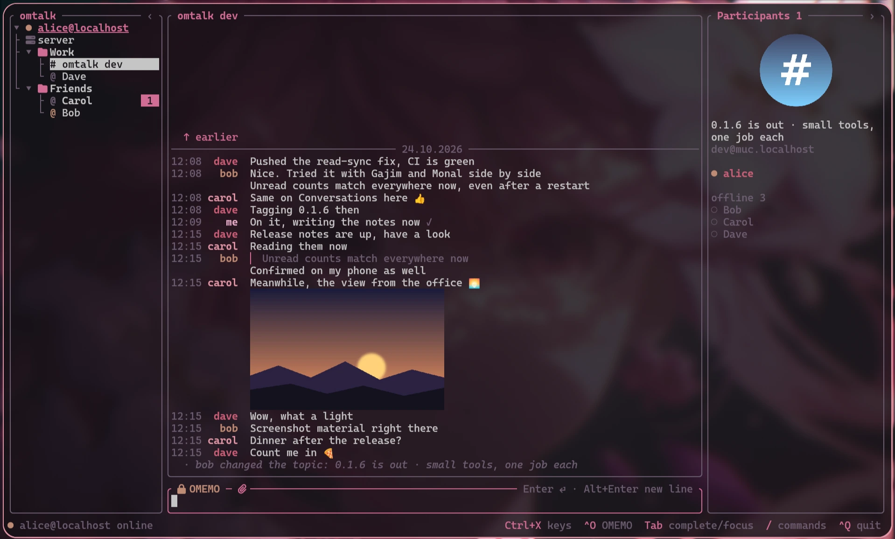
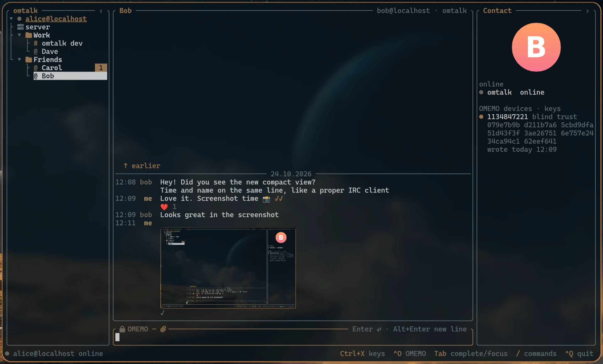

# omtalk

[English](README.md) · **Русский**

Терминальный XMPP-клиент с OMEMO, который работает в личных и групповых чатах так же
надёжно, как Gajim.





## Окружение

Все версии инструментов зафиксированы в репозитории (`mise.toml`, `rust-toolchain.toml`,
`tests/oracle/uv.lock`):

```sh
git clone https://github.com/gAlleb/omtalk.git && cd omtalk
mise trust && mise install
mise run test
```

`mise run test` поднимает и тестовый Prosody в Docker (`tests/prosody`, слушает только
`127.0.0.1:15222`, каждый запуск с пустыми данными, аккаунты `alice`…`frank` и `u01`…`u60` `@localhost` с паролем `test`; `admin@localhost` —
администратор сервера, для проверки ad-hoc команд; служба загрузки файлов
`upload.localhost`, HTTP на `127.0.0.1:15280`).

## Запуск

Файлы для раздачи: `mise run dist` кладёт в `dist/` статические `omtalk-x86_64` и
`omtalk-aarch64`, они запускаются на любом Linux без библиотек. Только для ARM
(Raspberry Pi 4/5 и т.п.): `mise run build-arm`. Получится один
статический файл `target/aarch64-unknown-linux-musl/release/omtalk`, который работает на
любом Linux для aarch64 без библиотек. Компилятор C для этой сборки — zig из `mise.toml`,
в систему ничего не ставится.

```sh
cargo build --release -p omtalk
target/release/omtalk you@example.org      # один аккаунт
target/release/omtalk                      # аккаунты из ~/.config/omtalk/config.toml
```

Несколько omtalk с разными аккаунтами работают рядом. Аккаунт в базе
(`~/.local/share/omtalk/omtalk.db`) — одно устройство OMEMO, поэтому открыт сразу только в
одном omtalk: две копии выбивали бы друг друга из сети. Второй клиент того же аккаунта на
той же машине — отдельное устройство: `omtalk --db ~/.local/share/omtalk/second.db`.

```toml
# ~/.config/omtalk/config.toml
[[account]]                               # аккаунтов может быть сколько угодно
jid = "you@example.org"
password_command = "pass show xmpp/you"   # иначе пароль спросят при запуске
# host = "xmpp.example.org"               # сервер напрямую, без SRV (STARTTLS)
# port = 5222
# direct_tls = "xmpp.example.org:5223"    # или сразу TLS

[ui]
leader = "ctrl+x"      # префикс, как в tmux: нажать, отпустить, затем буква
modifier = "ctrl"      # ctrl, alt, super или none — те же сочетания, удерживая
icons = "nerd"         # nerd (значки Nerd Font) или text
left = 26              # ширина списка чатов
right = 30             # ширина правой панели
viewer = "xdg-open"    # чем открывать файл по клику
auto_download = true   # false — присланные файлы только по клику («скачать»)
mouse = true           # false — мышь у терминала (выделение как в tmux); префикс+m переключает
read_markers = true    # false — собеседник не видит, что вы прочитали
typing = true          # false — собеседник не видит, что вы печатаете
avatars = false        # true — аватарки собеседника и комнаты в правой панели
compact = false        # true — время и имя в строке сообщения, как в IRC-клиентах
language = "ru"        # язык интерфейса: en (по умолчанию) или ru

[notify]               # у каждого: all, private, mention, private+mention или none
sound = "canberra-gtk-play -i message-new-instant"   # любая команда; "" — без звука
sound_on = "private+mention"   # личные и упоминание ника в комнате
desktop_on = "private+mention" # notify-send
bell_on = "all"                # звонок терминала (\a): по нему tmux и mango отмечают окно

[theme]                # по желанию: любой роли — свой цвет; остальные — из палитры терминала
accent = "#7aa2f7"     # имя (blue, bright-red, gray), #rrggbb или номер 0–255; default — терминала
# text, background, dim, border, ok, warn, outgoing — так же
# selection_text = "black"  selection_background = "yellow"   # выделенная строка
# nicks = ["red", "green", "#ff8800"]                         # цвета ников по кругу
```

Интерфейс по умолчанию английский; `language = "ru"` в `[ui]` или строка «Language / Язык»
в настройках включает русский, сразу.

Настройки из `[ui]` и `[notify]` можно менять и в самом omtalk: `/settings` или
префикс+`p`. Стрелки выбирают, `Enter` или клик меняет, `←`/`→` листают значения.
Изменение действует сразу и записывается в `config.toml`, комментарии в нём остаются.
Цвета `[theme]` и аккаунты правятся только в файле.

Аватарки, как в Gajim: `avatars = true` или «Аватарки» в настройках, по умолчанию
выключены. Аватарка собеседника или комнаты видна вверху правой панели. Берётся оттуда
же, откуда её берут другие клиенты: из PEP (XEP-0084, смена приходит сама), иначе из
vCard (XEP-0054/0153), у комнаты — из её vCard. Скачанные лежат в
`~/.cache/omtalk/avatars` под своим SHA-1. Аватарки круглые: в kitty это настоящая
картинка, в Alacritty — круг из полублоков. Они же в уведомлениях: из лички — аватарка
собеседника, из комнаты — аватарка комнаты с маленькой аватаркой написавшего в углу (если
комната показывает, кто это).

Три колонки: чаты, переписка, участники или устройства собеседника. С несколькими
аккаунтами чаты слева сгруппированы по аккаунтам. Клик по заголовку аккаунта (или `←`
в списке чатов) сворачивает его чаты, у свёрнутого видно число непрочитанных. Префикс+`z`
оставляет открытым только текущий аккаунт, повторно открывает все. Команды идут от аккаунта на
сервере собеседника, иначе от последнего выбранного (он подчёркнут). Клик по нику в
комнате или по участнику открывает личный чат с ним.

Свои папки, внутри каждого аккаунта (только в omtalk, могут содержать и комнаты): список
слева — дерево «аккаунт → папки → чаты». `/folder ИМЯ` кладёт текущий чат в папку его
аккаунта (новую создаёт), `/folder` без имени вынимает. Ещё можно перетащить чат мышью на
заголовок папки или обратно на аккаунт. Папка
сворачивается так же, как аккаунт. Пустая папка исчезает. `/folder-up` и `/folder-down` двигают папку открытого чата, либо перетащите заголовок
папки на другую. `/rename-folder СТАРАЯ НОВАЯ`
(для имён с пробелами — `старая папка → новая`). Цвета берутся из
палитры терминала (pywal и подобные перекрашивают omtalk вместе со всем), а в `[theme]`
любую роль можно задать своим цветом. Мышь: клик по чату, перетаскивание границ панелей, `‹`/`›` прячут
панели, клик по замку у поля ввода включает и выключает OMEMO для чата, колесо листает.
Клавиши: префикс `leader` (Ctrl+X), отпустить, затем буква — после префикса всплывает
список: `o` — OMEMO, `b`/`r` — левая и правая панели, `↑`/`↓` — чаты, `←`/`→` — ширина
списка, `s` — сервисы, `p` — настройки, `z` — только текущий аккаунт, `q` — выход (или Ctrl+C дважды). Те же буквы работают с
удержанным `modifier`, кроме тех, что нужны полю ввода. `Tab` — фокус, `PgUp`/`PgDn` —
листать. Набор текста в любой другой панели уходит в поле ввода (фокус переходит туда):
любая буква набирается, панели листаются `↑`/`↓`, `Home`/`End` и мышью. В комнате `Tab`
после поля ввода переходит к участникам справа: `↑`/`↓`
выбирают, `Enter` открывает личный чат, `Esc` возвращает в поле ввода. Поле ввода редактируется как в shell: Ctrl+W/U/K вырезают слово, до начала, до
конца, Ctrl+Y вставляет вырезанное, Ctrl+A/E — начало и конец, Ctrl+←/→ и Alt+B/F — по
словам. Alt+Enter (или Shift+Enter, где терминал его отличает) — новая строка в
сообщении. `↑`/`↓` листают отправленное с запуска omtalk (сообщения и команды), как в
shell; в многострочном тексте сначала ходят по его строкам. Вставленный текст из нескольких строк уходит одним сообщением, с отступами; поле
ввода растёт до 8 строк. Ошибки показываются в нижней строке целиком и гаснут через 10 с;
полностью они остаются в служебном канале аккаунта.

Разметка сообщений, как в Conversations, Gajim, Monal и Dino (XEP-0393): `*жирный*`,
`_курсив_`, `~зачёркнутый~`, `` `код` ``, блок кода между строками ```` ``` ```` и цитаты
`>` в любом месте сообщения. Символы разметки остаются видны приглушённо: скопированный текст —
ровно то, что написано; внутри кода ничего не размечается.

`/me машет` уходит как написано и показывается как `* ник машет`, как в IRC и Gajim
(XEP-0245).

Файлы и картинки: `/upload путь` (Tab дописывает путь), скрепка у поля ввода, файл,
перетащенный в окно терминала (появится готовая команда — Enter), или Ctrl+V с картинкой
в буфере. Файл уходит на службу загрузки своего сервера (XEP-0363); в зашифрованном чате он
сначала шифруется, и собеседник получает ссылку `aesgcm://` (XEP-0454), как от Gajim,
Conversations и Monal. У строки виден процент загрузки, затем обычные ✓ и ✓✓; своя
картинка показывается сразу, без повторной загрузки.

Присланные файлы и картинки скачиваются сами; `auto_download = false` в `[ui]` — только
по клику: у файла написано «скачать». Уже скачанное показывается сразу.

Ответы и цитаты (XEP-0461), как в Conversations, Gajim и Monal: двойной клик по сообщению,
префикс+`a` (ответ на последнее входящее) или `/reply`. Выделенный
мышью кусок сообщения — это то, что будет процитировано. Пока пишется ответ, над полем
ввода видно, на что; Esc отменяет. Цитата уходит строками `> ` в начале текста (её видно в
любом клиенте) и пометкой, на какое сообщение это ответ. Первой строкой цитаты идёт ник
автора («> bob:»), чтобы было видно, чьи слова, и в клиентах без ответов. В omtalk цитата
показывается блоком с полосой слева и именем того, кому отвечают.

Ключи OMEMO, как в Gajim: `/keys [адрес]`, префикс+`e` или клик по устройствам справа
от личного чата. Видны устройства собеседника и ваши, с отпечатками и статусом: `●`
вслепую, `✓` проверено, `✗` не доверяю или не решено. Сравнив отпечаток с тем, что
показывает клиент собеседника, отметьте устройство проверенным (`v`). После первой
проверки новые устройства этого собеседника ждут вашего решения и сообщений не получают
(«доверие вслепую до проверки», как в Gajim и Conversations). `d` — не доверять, `b` —
снова вслепую, `x` — удалить своё старое устройство из списка (дважды). Сообщение с
непроверенного или отвергнутого устройства помечено `⚠`. У каждого устройства видно, когда
оно писало последний раз («писало вчера 14:05»): молчащее месяцами сразу заметно.

Мышь и буфер обмена. Протянуть мышью по сообщениям — выделить и скопировать: только текст
сообщений, без рамок и соседних панелей, сразу в обычный буфер и в primary (через
`wl-copy`, а без Wayland — запросом к терминалу OSC 52; в tmux он проходит при
`allow-passthrough on`). Средняя кнопка вставляет primary, Ctrl+V в поле ввода — обычный
буфер (через `wl-paste`). Префикс+`m` (или `mouse = false` в `[ui]`) отдаёт мышь
терминалу: тогда tmux и терминал выделяют и вставляют сами, как в WeeChat без мыши;
префикс+`m` возвращает. Shift с мышью работает всегда: терминал на это время забирает мышь
себе.

У каждого аккаунта наверху списка — служебный канал «сервер»: вход и переподключения,
своё устройство OMEMO с отпечатком, итог догрузки из архива, вход в комнаты, свои другие
клиенты (пришёл, ушёл), ошибки, запросы подписки, сообщения самого сервера. Справа — сам
аккаунт и какие его клиенты сейчас в сети.

Окно не в фокусе: сообщения не отмечаются прочитанными (ни собеседнику, ни своим
клиентам), пока не вернёшься в окно, и считаются непрочитанными даже в открытом чате.

Уведомления — три сигнала, каждый настраивается в `[notify]` отдельно: звук (любая
команда), всплывающее уведомление (`notify-send`) и звонок терминала (`\a`). Для каждого —
на какие сообщения: личные (`private`), упоминание своего ника в комнате (`mention`), то и
другое, все (`all`) или никакие (`none`). Сигналов нет, пока смотришь на этот чат, и на
историю, догруженную из архива сервера. В tmux
можно выключить звонок (`bell_on = "none"`), а звук и уведомления останутся. Терминал сообщает о фокусе
сам (foot, kitty, Alacritty); в tmux для этого нужно `set -g focus-events on`, без него
omtalk считает окно всегда активным, как раньше.

`/mute` выключает все уведомления открытого чата, `/unmute` возвращает их.
То же — клик по колокольчику рядом со скрепкой над полем ввода. Работает одинаково
для лички, XMPP-комнаты и IRC-канала через biboumi: ни звука, ни всплывающего
уведомления, ни звонка терминала, даже при упоминании. Слева у чата виден значок мьюта
(в текстовом режиме — `[тихо]`). Сообщения и непрочитанные остаются; мьют сохраняется
после перезапуска и действует только в этом omtalk.

«Печатает…» (XEP-0085): пока собеседник набирает текст, внизу переписки видно «bob
печатает…», а в списке у чата — `…`. omtalk сам сообщает о наборе: начали — «печатает»,
10 с без клавиш — «пауза», отправили — конец. `typing = false` в `[ui]` выключает.

Комнаты: `/create имя [Название]` создаёт закрытую комнату (только для участников, с
видимыми адресами — как нужно OMEMO, постоянную) на сервисе комнат своего сервера и
входит в неё; `/invite адрес` делает человека участником и зовёт его (прямое приглашение,
XEP-0249, как в Gajim и Conversations). Приглашение, пришедшее вам, видно в служебном
канале с готовой командой `/join`. У комнаты слева и в заголовке — её название, рядом —
тема; смена темы видна в чате. `/topic текст` меняет тему, `/name Название` — название
(только владелец). `/nick ник` меняет свой ник в комнате, `/nick` без ника возвращает
обычный (адрес до `@`); смена ника у других видна в чате («alice теперь алиса»), человек
в списке остаётся тем же.

Кроме адреса, есть три имени: свой ник в каждой комнате (`/nick`), своё имя для всех
(`/nickname Имя`, XEP-0172: его видят контакты, которые не дали вам своего имени) и имя,
которое вы даёте контакту и видите только вы (`/name Имя` в чате с ним; хранится в
контактах на сервере, для всех ваших клиентов). Каждая команда без имени его убирает.

В правой панели комнаты сверху — тема и адрес комнаты. Владельцы, админы, модераторы и
члены комнаты отмечены, как в IRC (`~`, `@`, `%`, `+`), и стоят выше остальных.

В правой панели комнаты — кто в ней сейчас, а ниже «не в сети»: члены комнаты (владельцы,
администраторы, участники), которых в ней нет. Клик по ним открывает личный чат. Открытые
комнаты свои списки могут не показывать, тогда раздела нет.

Кто в сети и на чём: у личного чата значок `@` зелёный, пока собеседник в сети; в
заголовке чата и справа видно, с каких клиентов (Gajim, Monal, Conversations, omtalk…),
в каком они состоянии и с какой подписью. Клиент узнаётся по его caps (XEP-0115). Писать туда можно только команды.

У своих сообщений видно, как далеко они ушли: `⋯` отправляется, `✓` на сервере (в комнате —
комната прислала его обратно), `✓✓` доставлено клиенту собеседника (XEP-0184), `✓✓`
выделенные — прочитано (XEP-0333), `✗` — не отправлено, с причиной. omtalk сам отвечает
квитанциями. Открытый чат omtalk отмечает прочитанным: собеседнику (`read_markers = false`
в `[ui]` это выключает) и своим другим клиентам (XEP-0490). Gajim, Monal и Conversations
тогда гасят у себя непрочитанные. Прочитанное в них гасит непрочитанные в omtalk. Набранная `/` показывает над полем ввода список команд с пояснениями (`/help` —
то же). `Tab` дописывает команду, ник в комнате (в начале строки с `: `), адрес после
`/msg`, `/add` и т.п., комнату после `/join`, папку после `/folder`. Повторный `Tab` идёт по
вариантам, `Shift+Tab` назад. В пустой строке `Tab` переключает фокус. Команды в поле ввода: `/msg`, `/join`, `/leave`, `/add`, `/remove`, `/accept`, `/refuse`,
`/devices`, `/services [адрес]`, `/folder`, `/rename-folder`, `/create`, `/invite`, `/topic`,
`/name`, `/nick`, `/nickname`, `/reply`, `/react`, `/edit`, `/search`, `/away`, `/dnd`, `/online`, `/me`, `/keys`, `/upload`, `/commands`, `/settings`, `/close`, `/help`, `/quit`.
Чат закрывается `/close`, префиксом+`w` или средней кнопкой по нему в списке: он исчезает
слева, история остаётся, и он вернётся сам, когда в нём напишут. Комнату `/close`
закрывает только здесь (omtalk выходит из неё и не входит после перезапуска, другие ваши
клиенты входят как прежде); `/leave` выходит насовсем — снимает «входить автоматически» в
её закладке для всех клиентов. `/join` открывает её снова.
`/join` без ника берёт ник из закладок аккаунта (XEP-0402), как Gajim и другие клиенты, —
так все клиенты одного аккаунта в комнате считаются одним участником. Новая комната сама
добавляется в закладки.

Исправления (XEP-0308), как в Gajim и Conversations: `/edit` подставляет в поле ввода ваше
последнее сообщение в чате; Enter отправляет исправленный текст, Esc отменяет. Исправленное
сообщение — ваше или чужое — меняется на месте и помечается «изм.».

После долгого отсутствия пропущенное в комнате читается и сохраняется целиком (OMEMO
нужно читать по порядку), но в окне — только последние несколько сотен; внизу видно,
сколько уже прочитано.

Старая история: прокрутите выше самого старого показанного сообщения (или нажмите
«↑ раньше» над ним) — придут 50 предыдущих: сначала из того, что хранит это устройство,
потом из архива сервера (MAM). Зашифрованное до появления этого устройства там не
прочитать — оно только считается, как в любом клиенте OMEMO.

Поиск: `/search слова` ищет в хранящейся здесь истории открытого чата без учёта регистра,
и в зашифрованных сообщениях тоже (они хранятся расшифрованными). Результаты — поверх чата;
`↑`/`↓` и Enter (или клик) показывают чат с этого сообщения, Esc закрывает.

Свой статус: `/away [слова]`, `/dnd [слова]`, `/online [слова]` — сразу для всех
аккаунтов, и он сохраняется после перезапуска. Его видят контакты и комнаты, где вы сейчас
(omtalk время от времени спрашивает комнаты, там ли вы ещё, и входит снова, если нет); после переподключения и при входе
в комнату он говорится снова, внизу виден у аккаунта. Статусы участников комнаты видны справа.

Реакции (XEP-0444): правый клик по сообщению предлагает 👍 💖 😂 😮 😢 🙏; клик ставит,
повторный снимает. `/react 👍` делает то же для выделенного мышью сообщения или последнего
чужого и понимает имена (`/react :+1:`, `heart`, `joy`, `fire`…). Реакции видны под сообщением, у каждой — сколько человек
её поставили. Как в Conversations и Gajim, они идут без шифрования, и в зашифрованном чате
тоже.

Сервисы — как «Обзор сервисов» и «Выполнить команду» в Gajim. Окно показывает, что
предлагает сервер (или любой адрес): службы, их узлы и ad-hoc команды (XEP-0050). Команда
открывает форму (XEP-0004): текст, пароль (скрыт), флажок, выбор из списка, несколько
значений. Клавиши: `Enter` — открыть или следующий шаг, `←`/`Backspace` — назад, `Tab` —
следующее поле, `Пробел` — флажок или выбор, `Esc` — отменить команду на сервере и
закрыть. Мышью работают строки, поля и кнопки. Администратору своего сервера здесь
доступно управление: пользователи, пароли, модули, статистика.

Команды самого чата, как «Выполнить команду» в Gajim: `/commands` или префикс+`c`. У
комнаты (и канала моста), у клиента собеседника, пока он в сети, у своего сервера — из
служебного канала. В канале biboumi (`#канал%irc.сервер@biboumi…`) `←` ведёт к командам
IRC-сервера: порт, TLS, пароль, ник, держать ли канал подключённым. Результат из нескольких
записей (XEP-0004 `<reported>`) показывается таблицей, длинную листают стрелки.

## Проверка с другими клиентами: omtalk-cli

Строчный OMEMO-клиент для живой проверки с Gajim, Monal, Conversations и Dino, пока
интерфейса нет:

```sh
cargo build --release -p omtalk-cli
target/release/omtalk-cli you@example.org
```

Пароль берётся из `OMTALK_PASSWORD` или спрашивается. Данные лежат в
`~/.local/share/omtalk/omtalk.db` (`--db` меняет путь), поэтому каждый запуск — то же
устройство. Сервер находится по SRV-записям домена; `--host HOST [--port PORT]` задаёт
STARTTLS вручную, `--direct-tls HOST:PORT` — прямой TLS. Команды: `/msg`, `/join`, `/say`,
`/devices` (отпечатки в виде, как у Gajim), `/help`, `/quit`.

## Устройство

| Каталог | Что там |
|---|---|
| `crates/omemo` | OMEMO 0.3: X3DH, Double Ratchet, формат libsignal, полезная нагрузка AES-GCM. Без XML и сети |
| `crates/omemo-xml` | OMEMO на проводе: devicelist, bundle, `<encrypted>` поверх типов xmpp-parsers; шифрование одного сообщения для многих устройств |
| `crates/xmpp` | соединения для нескольких аккаунтов, проверка пароля, keepalive, обязательные ответы клиента (disco, ping, caps), PEP, MUC (вход, закрытая комната, участники), архив сообщений (MAM), аватарки |
| `crates/omemo-client` | OMEMO для аккаунта: своё устройство в списке, carbons, шифрование для всех устройств собеседника и своих, группы (все участники, включая отсутствующих), доверие BTBV, догрузка пропущенного из архива |
| `crates/store` | SQLite-файл с данными клиента: состояние OMEMO каждого аккаунта (ключи, сессии, доверие), история, комнаты, папки |
| `crates/testkit` | только для тестов: «устройство» — клиент со своим соединением и ключами против тестового Prosody |
| `crates/tui` | `omtalk`: интерфейс в терминале (ratatui) |
| `crates/media` | общие файлы: `aesgcm://` (XEP-0454) и `https://`, загрузка, расшифровка, кэш |
| `crates/cli` | `omtalk-cli`: строчный клиент для живой проверки |
| `crates/omemo-oracle` | только для тестов: запуск эталонного устройства и разговор с ним |
| `tests/prosody` | одноразовый Prosody 13 для интеграционных тестов |
| `tests/oracle` | эталонное устройство на python-omemo; `crates/omemo/tests/oracle.rs` сверяется с ним байт в байт |
