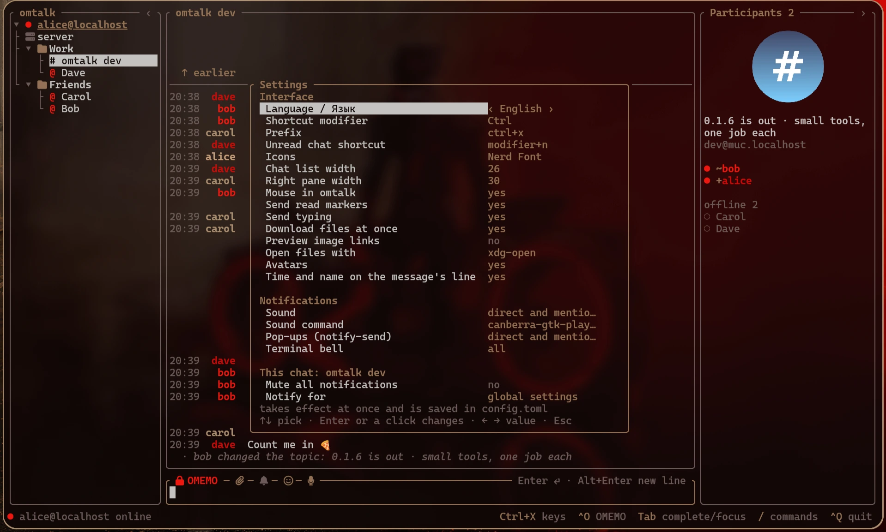
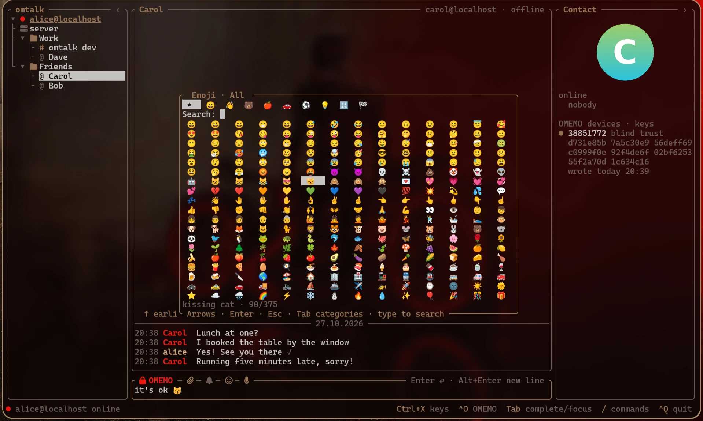

# omtalk

[English](README.md) · **Русский**

Терминальный XMPP-клиент для личных и групповых чатов: шифрование OMEMO, несколько
аккаунтов, управление клавиатурой и мышью.

## Возможности

- OMEMO в личке и закрытых группах, проверка отпечатков и управление доверием устройств.
- Несколько аккаунтов, папки чатов, закладки комнат и IRC через мост biboumi.
- Ответы, исправления, реакции со списком поставивших и оформление сообщений.
- Зашифрованные файлы, картинки, поиск по локальной истории и догрузка архива сервера.
- Синхронизация прочитанного между устройствами, мьют чатов и настройка уведомлений.
- Цвета из палитры терминала, аватарки по желанию, русский и английский интерфейс.

## Содержание

- [Установка и первый запуск](#установка-и-первый-запуск)
- [Управление](#управление)
- [Переписка](#переписка)
- [Аккаунты и комнаты](#аккаунты-и-комнаты)
- [Шифрование и устройства](#шифрование-и-устройства)
- [Настройки и уведомления](#настройки-и-уведомления)
- [Справочник команд](#справочник-команд)
- [Разработка и тестирование](#разработка-и-тестирование)
- [Лицензия](#лицензия)






## Установка и первый запуск

### Готовые файлы для Linux

Скачайте `omtalk-x86_64` или `omtalk-aarch64` под свою архитектуру со
[страницы релизов](https://github.com/gAlleb/omtalk/releases). Файлы статические:
для запуска клиента не нужны системные библиотеки. Например, для x86_64:

```sh
chmod +x omtalk-x86_64
./omtalk-x86_64 you@example.org
```

Введите пароль аккаунта при запросе. После подключения `/msg friend@example.org`
откроет личный чат, `/join room@conference.example.org` — комнату. Наберите `/`,
чтобы увидеть команды, или нажмите и отпустите Ctrl+X для меню сочетаний клавиш.

По умолчанию значки требуют Nerd Font. Если в вашем шрифте их нет, задайте
`icons = "text"` в `[ui]`. Команды для буфера обмена, уведомлений и открытия файлов
описаны ниже.

### Сохранённые аккаунты

Для запуска без адреса создайте `~/.config/omtalk/config.toml`:

```toml
[[account]]
jid = "you@example.org"
# password_command = "pass show xmpp/you"
```

Запустите клиент без аргументов — он загрузит аккаунты из конфига. Для каждого
аккаунта добавьте свой блок `[[account]]`. Без `password_command` пароль спрашивается
при запуске. Интерфейс по умолчанию английский; `[ui] language = "ru"` или пункт
Language в настройках включает русский.

### Сборка из исходников

Версии инструментов закреплены в `mise.toml` и `rust-toolchain.toml`:

```sh
git clone https://github.com/gAlleb/omtalk.git
cd omtalk
mise trust
mise install
cargo build --release -p omtalk
target/release/omtalk you@example.org
```

`mise run dist` собирает статические файлы для x86_64 и aarch64 и `SHA256SUMS` в `dist/`.
`mise run build-arm` — только `target/aarch64-unknown-linux-musl/release/omtalk`
(для Raspberry Pi 4/5 и других машин с Linux на aarch64). Для кросс-компиляции используется
закреплённый zig; системный кросс-компилятор устанавливать не нужно.

## Управление

### Панели и сочетания клавиш

Три колонки: чаты, переписка, участники комнаты или устройства собеседника. Клик выбирает
чат, перетаскивание границ меняет ширину панелей, `‹`/`›` скрывают их. Колесо листает.
`Tab` меняет фокус, `PgUp`/`PgDn` листают переписку. Если история прокручена вверх,
`End` возвращает к последнему сообщению, в том числе из поля ввода; клик «↓ End»
делает то же. Внизу чата `End` по-прежнему перемещает курсор ввода. Набор текста в другой панели
переводит фокус в поле ввода и вводит текст. В списках работают стрелки и `Home`/`End`.

Префикс по умолчанию — **Ctrl+X**: нажать, отпустить, затем клавишу. После префикса
появляется меню. Ниже «префикс» означает эту последовательность, а не удержание Ctrl+X.

| Клавиша после префикса | Действие |
|---|---|
| `↑` / `↓` | Предыдущий / следующий чат |
| `b` / `r` | Скрыть или показать левую / правую панель |
| `←` / `→` | Сузить / расширить список чатов |
| `z` | Оставить текущий аккаунт; повторно — показать все |
| `o` | Переключить OMEMO в чате |
| `a` | Ответить на последнее входящее сообщение |
| `n` | Первый непрочитанный чат |
| `e` | Открыть ключи OMEMO |
| `s` / `c` | Обзор сервисов / команды текущего чата |
| `p` | Настройки |
| `m` | Отдать мышь терминалу / вернуть клиенту |
| `w` | Закрыть чат |
| `q` | Выйти; также работает Ctrl+C дважды |

`leader` меняет префикс, `modifier` позволяет использовать сочетания с удержанием Ctrl,
Alt или Super, кроме комбинаций, нужных полю ввода. Оба параметра — в `[ui]`.
В комнате `Tab` после поля ввода выбирает участников: стрелки — выбрать человека,
`Enter` — открыть личку, `Esc` — вернуться к вводу.

Переход к первому непрочитанному по порядку списка: модификатор+N (по умолчанию
Ctrl+N) или префикс+N. Учитываются все аккаунты, свёрнутые папки раскрываются.
Мьют не меняет счётчик: замьюченные чаты тоже участвуют. Если непрочитанных нет,
выбор остаётся на месте. Сочетание можно поменять в `/settings` → «Переход к
непрочитанным» или через `[ui] unread_shortcut = "f8"`. Значение `"modifier+n"`
следует основному модификатору, `"none"` выключает прямое сочетание; префикс+N остаётся.

### Ввод и дополнение

Поле ввода работает как командная оболочка: Ctrl+W/U/K вырезают слово, до начала или до
конца строки; Ctrl+Y вставляет вырезанное; Ctrl+A/E идут в начало/конец; Ctrl+←/→ или
Alt+B/F — по словам. `↑`/`↓` перебирают сообщения и команды с момента запуска, а в
многострочном тексте сначала ходят по строкам. Alt+Enter (или Shift+Enter, где терминал
его различает) начинает новую строку. Вставленный многострочный текст отправляется
одним сообщением с сохранением отступов; поле растёт до восьми строк.

`/` или `/help` показывает команды с пояснениями. `Tab` дополняет команды, ники,
адреса, комнаты, папки и пути загрузки; повторное нажатие перебирает варианты,
Shift+Tab возвращается назад. К нику в начале строки добавляется `: `.
В пустом поле `Tab` переключает фокус.

### Мышь и буфер обмена

Протяните мышью по сообщениям, чтобы выделить и скопировать только текст, без рамок
и соседних панелей. В Wayland используется `wl-copy`, сразу для обычного буфера и
primary, в X11 — `xclip` (или `xsel`); иначе — OSC 52 через терминал. Средняя кнопка
вставляет primary, Ctrl+V — обычный буфер через `wl-paste`, `xclip` или `xsel`,
включая картинки для загрузки (`wl-paste` и `xclip`; `xsel` умеет только текст).

Префикс+`m` (или `mouse = false`) отдаёт выделение и вставку терминалу. Shift с мышью
делает то же временно. В tmux для пропуска OSC 52 нужно `set -g allow-passthrough on`.

## Переписка

### Ответы, исправления и оформление

Двойной клик по сообщению, `/reply` или префикс+`a` начинает ответ. Если мышью выделена
часть сообщения, цитируется она. Над вводом виден адресат ответа; `Esc` отменяет.
Ответ содержит ссылку XEP-0461 и текстовую цитату с ником автора, поэтому контекст
виден и в других клиентах.

`/edit` подставляет в поле ввода ваше последнее сообщение в чате. `Enter` отправляет
исправление, `Esc` отменяет. Сообщение меняется на месте с пометкой «изм.» (XEP-0308).

Оформление (XEP-0393): `*жирный*`, `_курсив_`, `~зачёркнутый~`, `` `код` ``, блоки кода
между тройными обратными кавычками и цитаты `>`. Знаки разметки остаются видимыми,
приглушёнными; копируется исходный текст. Внутри кода оформление не применяется.
`/me машет` показывается как `* ник машет` (XEP-0245).

### Реакции

Правый клик по сообщению предлагает 👍 💖 😂 😮 😢 🙏; повторный выбор снимает реакцию.
`/react 👍` действует на выбранное сообщение или последнее входящее. Поддерживаются
имена `:+1:`, `heart`, `joy`, `fire` и другие. Реакции (XEP-0444) видны под сообщениями,
в том числе вложениями, со счётчиком у каждого эмодзи. **Реакции отправляются без
шифрования, даже в зашифрованных чатах.**

Клик по строке реакций показывает, кто их поставил. `/reactions` открывает тот же
список для выбранного сообщения или последнего с реакциями. В комнатах видны ники,
в личке — имена контактов. Стрелки или колесо листают; `Esc` или клик снаружи закрывают.

### Файлы и картинки

Отправить файл можно через `/upload путь` с дополнением пути, скрепку или перетаскивание
файла в терминал с подтверждением готовой команды через `Enter`. Картинку из буфера —
через Ctrl+V. Файл загружается на сервис HTTP upload сервера (XEP-0363); в зашифрованном
чате он сначала шифруется и передаётся ссылкой `aesgcm://` (XEP-0454). Во время загрузки
виден прогресс, затем галки доставки. Своя картинка появляется сразу, без скачивания.

Входящие файлы скачиваются автоматически. При `[ui] auto_download = false` — только
по клику. Файлы из кэша видны сразу. Клик открывает файл через `viewer` (по умолчанию
`xdg-open`). Картинки используют графику Kitty, где она доступна; в Alacritty —
символьное превью.

Обычные HTTPS-ссылки на изображения можно показывать картинками: включите
«Картинки по ссылкам» в `/settings` или `[ui] image_links = true`. По умолчанию
выключено. Сообщение должно состоять из одной ссылки на `.png`, `.jpg`, `.jpeg`,
`.gif`, `.webp` или `.bmp`. Предпросмотр действует и на локальную историю;
`auto_download = false` оставляет загрузку по клику. Настройка не меняет показ
файлов, отправленных как вложения.

### История и поиск

Прокрутка выше самого старого сообщения или клик «↑ раньше» загружает 50 предыдущих:
сначала из локальной базы, затем из архива сервера (MAM). После долгого отсутствия
пропущенное в комнате обрабатывается и сохраняется по порядку, а в окне остаются
последние несколько сотен сообщений; внизу виден прогресс.

**Локальная история хранится расшифрованной**, включая сообщения OMEMO.
`/search слова` ищет в истории текущего чата на этом устройстве без учёта регистра.
Стрелки и `Enter` (или клик) переходят к результату; `Esc` закрывает поиск.
Сообщения, зашифрованные до появления этого устройства, из архива расшифровать нельзя:
они учитываются в количестве, но не показываются читаемым текстом.

### Присутствие и доставка

Зелёный `@` у личного чата означает, что собеседник в сети. В заголовке и справа видны
его клиенты, состояние и подпись. `/away [текст]`, `/dnd [текст]` и `/online [текст]`
меняют ваш статус сразу для всех аккаунтов. Он сохраняется после перезапуска и
отправляется снова при подключении и входе в комнаты. Статусы участников видны справа.

| Значок | Значение |
|---|---|
| `⋯` | Отправляется или ждёт связи |
| `✓` | Принято сервером; в комнате — получено эхо от комнаты |
| `✓✓` | Доставлено клиенту собеседника (XEP-0184) |
| Выделенные `✓✓` | Прочитано (XEP-0333) |
| `✗` | Не отправлено; указана причина |

Индикатор набора (XEP-0085) виден в переписке и как `…` у чата в списке. Ваш набор
переходит в «паузу» через десять секунд без ввода. `typing = false` отключает его
передачу.

## Аккаунты и комнаты

### Аккаунты, контакты и папки

Список чатов сгруппирован по аккаунтам. Клик по заголовку или `←` на нём сворачивает
аккаунт, сохраняя счётчик непрочитанных. Префикс+`z` оставляет только текущий аккаунт.
Адресные команды используют активный аккаунт, подчёркнутый в списке чатов. Выбор чата
или заголовка аккаунта меняет его; сервер адресата не меняет отправителя.

Чтобы выбрать другого отправителя для одной команды, сразу после её имени укажите
`--account` и полный JID настроенного аккаунта. `Tab` дополняет адрес аккаунта,
а затем адресата как обычно:

```text
/msg --account me@work.org friend@example.org привет
/join --account me@home.org room@conference.example.org
```

Параметр доступен для `/msg`, `/join`, `/add`, `/remove`, `/accept`, `/refuse`,
`/create`, `/keys` и `/services`. Неизвестный аккаунт вызывает ошибку, команда остаётся
в поле для исправления. `/remove --account АККАУНТ` требует также адрес контакта.
Команды открытого чата, например `/invite`, `/leave` и `/upload`, используют аккаунт
этого чата. В тексте сообщения `--account` остаётся обычным текстом. Открытие чата
через `/msg --account` выбирает этот чат и делает его аккаунт активным.

`/msg адрес` открывает личку, `/add адрес [имя]` добавляет контакт. `/accept` и `/refuse`
с адресом отвечают на запрос подписки. `/name Имя` в личке задаёт ваше название контакта
в ростере, общее для ваших клиентов; `/name` убирает его. `/nickname Имя` публикует ваше
собственное имя; без имени — убирает его. `/avatar путь` ставит вашу аватарку из картинки
(середина картинки квадратом, не больше 256×256, в PNG); `/avatar` без пути — убирает её.
Путь дописывается по Tab.

Контакты, объявляющие в XMPP Service Discovery тип `client/bot`, отмечаются головой
робота в списке чатов и заголовке (`[бот]` в текстовом режиме). Проверка идёт при
открытии лички, в том числе для известных подключённых ресурсов; по имени бот
не угадывается. Подтверждённая отметка сохраняется локально после перезапуска.

Папки локальны для omtalk и принадлежат аккаунту. `/folder ИМЯ` перемещает текущий чат
в папку, создавая её при необходимости; `/folder` вынимает его. То же можно сделать
перетаскиванием чата на папку или обратно на аккаунт. Пустые папки исчезают.
`/folder-up`, `/folder-down` или перетаскивание заголовков меняют порядок папок.
`/rename-folder СТАРАЯ НОВАЯ` переименовывает; для имён с пробелами используйте
`/rename-folder старая папка → новая папка`.

Служебный канал аккаунта показывает подключения, догрузку архива, ошибки, запросы
подписки, сообщения сервера и появление других ваших клиентов. Справа — аккаунт и
клиенты в сети. Вводить там можно только команды. Ошибки исчезают из нижней строки
через десять секунд, но остаются в этом канале.

### Вход и управление комнатами

`/join комната@сервис [ник]` входит в комнату. Без ника берётся ник из закладки аккаунта
(XEP-0402), чтобы клиенты могли использовать один ник. Новые комнаты добавляются
в закладки автоматически. `/create имя [Название]` создаёт постоянную закрытую комнату
с видимыми адресами участников, подходящую для OMEMO, и входит в неё. Можно указать
явное `имя@сервис`. `/invite адрес` добавляет участника и отправляет прямое приглашение
(XEP-0249). Входящие приглашения видны в служебном канале с готовой командой `/join`.

`/topic текст` меняет тему, `/name Название` — название комнаты (только владелец).
`/nick ник` меняет ваш ник в комнате, `/nick` возвращает обычный: опубликованное имя,
а если его нет — часть адреса до `@`. Смена ников участников показывается в переписке.

Справа видны тема, адрес комнаты, присутствующие и отсутствующие участники, если
комната раскрывает их список. Клик по нику или участнику открывает личку. Роли отмечены
как в IRC (`~`, `@`, `%`, `+`) и стоят выше остальных.

`/close`, префикс+`w` или средняя кнопка закрывают чат локально с сохранением истории;
личка появляется снова при новом сообщении. Из комнаты `/close` выходит и отключает
автоматический вход здесь, не меняя поведение других клиентов. `/leave` дополнительно
выключает автовход в общей закладке. `/join` открывает комнату снова.

### Сервисы и IRC-мосты

`/services [адрес]` открывает обзор служб и ad-hoc команд сервера (XEP-0050).
Формы поддерживают текст, пароли, флажки, одиночный и множественный выбор, таблицы
результатов (XEP-0004). `Enter` открывает или переходит дальше, `←`/`Backspace` — назад,
`Tab` — между полями, `Пробел` — выбор, `Esc` отменяет команду на сервере и закрывает её.
Строки, поля и кнопки работают мышью. Администратору доступны предоставляемые сервером
команды управления пользователями, паролями, модулями и статистикой.

`/commands` или префикс+`c` открывает команды текущей комнаты, клиента собеседника
в сети или своего сервера из его служебного канала. IRC доступен через XMPP-мост,
например biboumi, с адресами вида `#канал%irc.сервер@biboumi.example.org`.
В командах канала biboumi `←` ведёт к настройкам IRC-сервера: порт, TLS, пароль, ник,
постоянное подключение. Длинные таблицы результатов листаются стрелками.

## Шифрование и устройства

Клик по замку над вводом или префикс+`o` переключает OMEMO в чате.
Для шифрования группы нужна закрытая комната с видимыми адресами участников;
omtalk шифрует и для устройств отсутствующих участников.

`/keys [адрес]`, префикс+`e` или клик по устройствам в личке открывает устройства
собеседника и ваши собственные, с отпечатками и состоянием доверия:

| Значок / клавиша | Значение / действие |
|---|---|
| `●` | Доверие вслепую |
| `✓` | Проверено |
| `✗` | Нет доверия или решение не принято |
| `v` | Отметить выбранное устройство проверенным |
| `d` | Не доверять ему |
| `b` | Вернуть доверие вслепую |
| `x` дважды | Удалить своё старое устройство |

Перед проверкой сравните отпечатки с собеседником по доверенному каналу.
После первой проверки новые устройства этого контакта ждут вашего решения и не
получают сообщений (доверие вслепую до проверки). Сообщения с непроверенных или
отвергнутых устройств помечаются `⚠`. У каждого устройства видно, когда оно писало.

База `~/.local/share/omtalk/omtalk.db` содержит ключи, сессии, доверие и историю.
Каждый аккаунт в ней — одно устройство OMEMO. Разные аккаунты могут работать рядом;
второй процесс с тем же аккаунтом и базой не запускается. Для отдельного устройства
того же аккаунта на этой машине используйте другую базу:

```sh
omtalk --db ~/.local/share/omtalk/second.db you@example.org
```

## Настройки и уведомления

### Конфигурация

`/settings` или префикс+`p` меняет `[ui]` и `[notify]`. Стрелки выбирают параметр,
`Enter` или клик меняет его, `←`/`→` перебирают значения. Изменения действуют сразу
и сохраняются в `config.toml` с сохранением комментариев. Аккаунты и `[theme]` правятся
в файле. Пример ниже расширяет минимальный конфиг выше; все разделы, кроме аккаунтов,
необязательны.

```toml
# ~/.config/omtalk/config.toml
[[account]]                               # аккаунтов может быть сколько угодно
jid = "you@example.org"
password_command = "pass show xmpp/you"   # иначе пароль спросят при запуске
# host = "xmpp.example.org"               # сервер напрямую, без SRV (STARTTLS)
# port = 5222
# direct_tls = "xmpp.example.org:5223"    # или сразу TLS

[ui]
leader = "ctrl+x"      # префикс, как в tmux: нажать, отпустить, затем буква
unread_shortcut = "modifier+n" # переход к первому непрочитанному; можно "f8" или "alt+n"
modifier = "ctrl"      # ctrl, alt, super или none — те же сочетания, удерживая
icons = "nerd"         # nerd (значки Nerd Font) или text
left = 26              # ширина списка чатов
right = 30             # ширина правой панели
viewer = "xdg-open"    # чем открывать файл по клику
image_links = false    # true — обычная HTTPS-ссылка на картинку показывается превью
auto_download = true   # false — присланные файлы только по клику («скачать»)
mouse = true           # false — мышь у терминала (выделение как в tmux); префикс+m переключает
read_markers = true    # false — собеседник не видит, что вы прочитали
typing = true          # false — собеседник не видит, что вы печатаете
avatars = false        # true — аватарки собеседника и комнаты в правой панели
compact = false        # true — время и имя в строке сообщения, как в IRC-клиентах
language = "ru"        # язык интерфейса: en (по умолчанию) или ru

[notify]               # у каждого: all, private, mention, private+mention или none
sound = "canberra-gtk-play -i message-new-instant"   # любая команда; "" — без звука
sound_on = "private+mention"   # личные и упоминание ника в комнате
desktop_on = "private+mention" # notify-send
bell_on = "all"                # звонок терминала (\a): по нему tmux и mango отмечают окно

[theme]                # по желанию: любой роли — свой цвет; остальные — из палитры терминала
accent = "#7aa2f7"     # имя (blue, bright-red, gray), #rrggbb или номер 0–255; default — терминала
# text, background, dim, border, ok, warn, outgoing — так же
# selection_text = "black"  selection_background = "yellow"   # выделенная строка
# nicks = ["red", "green", "#ff8800"]                         # цвета ников по кругу
```

### Уведомления, мьют и прочитанное

Звук, всплывающие уведомления (`notify-send`) и звонок терминала (`\a`) настраиваются
независимо. Варианты: `all` — всё, `private` — личные, `mention` — упоминание вашего
ника в комнате, `private+mention` — оба, `none` — ничего. Для звука запускается указанная команда; в примере — `canberra-gtk-play`. Догрузка
архива и сообщения в чате, на который вы смотрите, не вызывают сигналов.

`/mute` или колокольчик рядом со скрепкой выключает **все** уведомления текущего чата,
включая упоминания. `/unmute` возвращает их. Личка, XMPP-комнаты и каналы biboumi работают
одинаково. Слева виден значок мьюта (`[тихо]` в текстовом режиме). Сообщения и счётчики
непрочитанных остаются; мьют сохраняется после перезапуска и действует в этом omtalk.

Для текущего чата откройте `/settings chat` (или раздел «Этот чат» в `/settings`):
мьют всех уведомлений; события «Как в общих / Все сообщения / Только упоминания»;
звук «Как в общих / Вкл / Выкл». Мьют подавляет все сигналы и сохраняет выбранные
правила. Настройки локальны для пары аккаунт+чат, включая IRC через мост, сохраняются
между запусками и не меняют общий конфиг. Для лички упоминание проверяется по вашему
опубликованному имени, иначе по части адреса до `@`. Явное включение звука использует
общую команду звука и фильтр этого чата; при наследуемом фильтре — все новые сообщения
чата. Пустая общая команда звука не воспроизводится. Всплывашки и звонок, отключённые
глобально, остаются выключенными. История и собственные сообщения не уведомляют.

Окно без фокуса не отмечает сообщения прочитанными, даже в открытом чате. В активном
окне omtalk отправляет отметки собеседнику (если не задано `read_markers = false`)
и синхронизирует прочитанное с другими вашими клиентами (XEP-0490). Локальные отметки
тоже сохраняются между запусками, в том числе для IRC-сообщений без ID архива.
Более новая известная отметка продвигает прочитанное; временные ошибки сети повторяются.

В tmux включите передачу фокуса, чтобы omtalk различал активное окно:

```tmux
set -g focus-events on
```

Без передачи фокуса окно считается активным. Чтобы оставить звук и всплывающие
уведомления, но выключить звонок для tmux, задайте `bell_on = "none"`.

### Оформление и аватарки

Цвета берутся из палитры терминала, включая изменения pywal. `[theme]` переопределяет
отдельные роли. `compact = true` помещает время и имя в первую строку сообщения.

Аватарки по умолчанию выключены; включите их в настройках или через `avatars = true`.
Справа видна аватарка собеседника или комнаты: графика Kitty в kitty, полублоки в
Alacritty. Аватарки контактов берутся из PEP (XEP-0084), иначе из vCard
(XEP-0054/0153); комнат — из vCard. Кэш: `~/.cache/omtalk/avatars`.
В уведомлениях — аватарка контакта или комнаты с маленькой аватаркой отправителя
в углу, если комната раскрывает его личность.

## Справочник команд

Квадратные скобки означают необязательные аргументы. Команды действуют на текущий чат,
если не указан адрес или в описании не сказано иначе.

| Раздел | Команда | Действие |
|---|---|---|
| Контакты | `/msg АДРЕС [ТЕКСТ]` | Открыть личку, при желании отправить текст |
| Контакты | `/add АДРЕС [ИМЯ]` | Добавить контакт |
| Контакты | `/remove [АДРЕС]` | Удалить указанный контакт или собеседника открытой лички |
| Контакты | `/accept АДРЕС`, `/refuse АДРЕС` | Ответить на запрос подписки |
| Имена | `/name [ИМЯ]` | Задать/убрать имя контакта; в комнате — задать название (оно обязательно) |
| Имена | `/nickname [ИМЯ]` | Задать/убрать опубликованное имя активного аккаунта |
| Имена | `/avatar [ПУТЬ]` | Поставить свою аватарку из картинки или убрать её |
| Комнаты | `/join АДРЕС [НИК]` | Войти в комнату |
| Комнаты | `/create ИМЯ [НАЗВАНИЕ]` | Создать комнату; ИМЯ может быть адресом |
| Комнаты | `/invite АДРЕС` | Добавить участника и пригласить в текущую комнату |
| Комнаты | `/topic [ТЕКСТ]` | Показать/сменить тему комнаты |
| Комнаты | `/nick [НИК]` | Сменить/сбросить свой ник в комнате |
| Комнаты | `/leave` | Выйти и отключить автовход в общей закладке |
| Чаты | `/close` | Закрыть чат локально |
| Папки | `/folder [ИМЯ]` | Переместить чат в папку или вынуть из неё |
| Папки | `/rename-folder СТАРАЯ НОВАЯ` | Переименовать; для имён с пробелами — `СТАРАЯ → НОВАЯ` |
| Папки | `/folder-up`, `/folder-down` | Поднять/опустить папку текущего чата |
| Сообщения | `/reply` | Ответить на выбранное сообщение или последнее входящее |
| Сообщения | `/edit` | Исправить своё последнее сообщение в чате |
| Сообщения | `/react ЭМОДЗИ`, `/reactions` | Переключить реакцию / посмотреть авторов |
| Сообщения | `/me ТЕКСТ` | Отправить действие |
| Сообщения | `/upload ПУТЬ` | Загрузить файл |
| История | `/search СЛОВА` | Поиск в локальной истории текущего чата |
| Статус | `/away [ТЕКСТ]`, `/dnd [ТЕКСТ]`, `/online [ТЕКСТ]` | Статус для всех аккаунтов |
| Устройства | `/devices` | Обновить список устройств открытой лички |
| Устройства | `/keys [АДРЕС]` | Открыть отпечатки и управление доверием |
| Уведомления | `/mute`, `/unmute` | Выключить/вернуть все уведомления чата |
| Сервисы | `/services [АДРЕС]` | Обзор сервисов |
| Сервисы | `/commands` | Команды текущего чата |
| Приложение | `/settings [chat]`, `/help`, `/quit` | Настройки, справка команд, выход |

## Разработка и тестирование

### Локальные тесты

После установки инструментов, описанной выше, при наличии Docker:

```sh
mise run test
```

Команда подготавливает эталон python-omemo по `tests/oracle/uv.lock`, запускает одноразовый
Prosody в Docker и выполняет `cargo test --workspace`. Сервер слушает только
`127.0.0.1:15222`, каждый раз стартуя с пустыми данными. Аккаунты `alice`…`frank` и
`u01`…`u80` на `localhost` имеют пароль `test`. `admin@localhost` — администратор
для проверки ad-hoc команд. Загрузка файлов: `upload.localhost`, HTTP на `127.0.0.1:15280`.

### Проверка с другими клиентами

`omtalk-cli` — строчный клиент для живых проверок OMEMO с Gajim, Monal, Conversations
и Dino:

```sh
cargo build --release -p omtalk-cli
target/release/omtalk-cli you@example.org
```

Пароль берётся из `OMTALK_PASSWORD` или спрашивается. По умолчанию база и устройство общие
с TUI; для отдельного тестового устройства используйте `--db`.
Сервер определяется через SRV. `--host HOST [--port PORT]` задаёт STARTTLS вручную,
`--direct-tls HOST:PORT` — прямой TLS. Среди команд — `/msg`, `/join`, `/say`, `/devices`,
`/help`, `/quit`.

### Структура проекта

| Каталог | Что там |
|---|---|
| `crates/omemo` | OMEMO 0.3: X3DH, Double Ratchet, формат libsignal, полезная нагрузка AES-GCM. Без XML и сети |
| `crates/omemo-xml` | OMEMO на проводе: devicelist, bundle, `<encrypted>` поверх типов xmpp-parsers; шифрование одного сообщения для многих устройств |
| `crates/xmpp` | соединения для нескольких аккаунтов, проверка пароля, keepalive, обязательные ответы клиента (disco, ping, caps), PEP, MUC (вход, закрытая комната, участники), архив сообщений (MAM), аватарки |
| `crates/omemo-client` | OMEMO для аккаунта: своё устройство в списке, carbons, шифрование для всех устройств собеседника и своих, группы (все участники, включая отсутствующих), доверие BTBV, догрузка пропущенного из архива |
| `crates/store` | SQLite-файл с данными клиента: состояние OMEMO каждого аккаунта (ключи, сессии, доверие), история, комнаты, папки |
| `crates/testkit` | только для тестов: «устройство» — клиент со своим соединением и ключами против тестового Prosody |
| `crates/tui` | `omtalk`: интерфейс в терминале (ratatui) |
| `crates/media` | общие файлы: `aesgcm://` (XEP-0454) и `https://`, загрузка, расшифровка, кэш |
| `crates/cli` | `omtalk-cli`: строчный клиент для живой проверки |
| `crates/omemo-oracle` | только для тестов: запуск эталонного устройства и разговор с ним |
| `tests/prosody` | одноразовый Prosody 13 для интеграционных тестов |
| `tests/oracle` | эталонное устройство на python-omemo; `crates/omemo/tests/oracle.rs` сверяется с ним байт в байт |

## Лицензия

GPL-3.0-or-later: GNU General Public License версии 3 или любой более поздней версии.
Полный текст — в [LICENSE](LICENSE).
